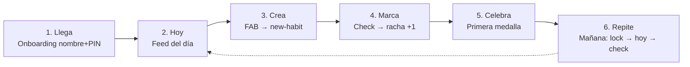
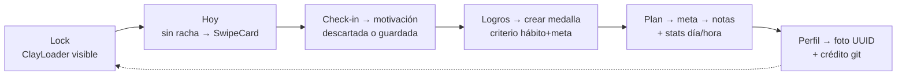

# Arquitectura de la Información — App Hábitos

> **Fase:** Producto y Flujos · **Paso 3** · Pulse Clay v1.0
> **Showcase interactivo:** [`Artefactos/documentacion/ArquitecturaInformacion/ARQUITECTURA_INFORMACION_VISUAL.html`](../../documentacion/ArquitecturaInformacion/ARQUITECTURA_INFORMACION_VISUAL.html)
> **Trazabilidad:** rutas de `ESTRUCTURA_DIRECTORIOS.md` · contratos de `CONTRATOS_API.md` · componentes del `manual-identidad-visual.md`
>
> **Versión 2 (V2)** — sitemap ampliado a **23 nodos** (los V1 intactos + hitos, stats, creadores). Showcase V2: [`ArquitecturaInformacion/ARQUITECTURA_INFORMACION_VISUAL.html`](../../ArquitecturaInformacion/ARQUITECTURA_INFORMACION_VISUAL.html)

---

## 1. Sitemap — 16 puntos de navegación

```mermaid
flowchart TB
  subgraph ARR[Arranque · sin tab bar]
    OW[onboarding/welcome]
    OS[onboarding/security]
    ON[onboarding/notifications]
    LK[lock · overlay global]
  end
  subgraph TABS[Tabs principales]
    HY[(tabs)/hoy]
    PL[(tabs)/plan]
    LG[(tabs)/logros]
    PR[(tabs)/perfil]
  end
  subgraph DET[Detalles · stack]
    HD[habit/id]
    GD[goal/id]
    SS[settings/security]
    SD[settings/data]
  end
  subgraph SH[Sheets y modales]
    NH[modal/new-habit]
    NG[modal/new-goal]
    CI[modal/check-in]
    CE[modal/celebration]
  end
  OW --> OS --> ON --> HY
  LK --> HY
  HY --> HD
  PL --> GD
  PL --> HD
  PR --> SS
  PR --> SD
  HY --> NH
  HD --> NH
  PL --> NG
  GD --> NG
  HY --> CI
  HY --> CE
  CE --> LG
```

| Capa | Nodos | Rutas |
|---|---|---|
| Arranque | Bienvenida, PIN+Bio, Notificaciones, Lock | `onboarding/*`, `lock` |
| Tabs | Hoy, Plan, Logros, Perfil | `(tabs)/*` |
| Detalles (stack) | Hábito, Meta, Seguridad, Datos | `habit/[id]`, `goal/[id]`, `settings/*` |
| Sheets/modales | Nuevo hábito, Nueva meta, Check-in, Celebración | `modal/*` |

### 1.1 Sitemap V2 — nodos nuevos (los V1 anteriores quedan intactos)

```mermaid
flowchart TB
  subgraph TABS[Tabs · R1 4 tabs sin cambios]
    HY[(tabs)/hoy\n+ SwipeCard Motivaciones]
    PL[(tabs)/plan\n+ barra progreso/meta]
    LG[(tabs)/logros\n+ Mis logros + creador]
    PR[(tabs)/perfil\n+ foto + crédito git]
  end
  subgraph DET2[Detalles V2 · stack]
    HI[hitos/index]
    HO[hito/[id] · carrusel]
    GS[goal/[id] · notas + stats]
    HS[habit/[id] · stats 30d/hora]
  end
  subgraph SH2[Sheets V2 · formSheet]
    NH2[modal/new-hito]
    NM[modal/new-motivacion]
    NL[modal/new-logro]
  end
  LG --> HI --> HO
  LG --> NL
  PL --> GS
  HY --> NM
  HY --> HO
  HS --> HI
  HO --> HS
  PR --> HY
```

| Nodo nuevo | Ruta | HU | Propósito |
|---|---|---|---|
| Hitos (lista) | `hitos/index` (stack) | HU-18 | Lista de hitos con fotos |
| Hito (detalle) | `hito/[id]` (stack) | HU-18 | Carrusel + comentarios |
| Stats de meta | en `goal/[id]` | HU-20 | ClayBars + Victory día/hora + notas |
| Stats de hábito | en `habit/[id]` | HU-26 | Tasa 30 d + hora pico + hitos ligados |
| Crear hito | `modal/new-hito` (formSheet) | HU-17 | Nombre+fecha+ligazones+≤10 fotos |
| Crear motivación | `modal/new-motivacion` (formSheet) | HU-24 | Texto ≤140 + meta + trigger |
| Crear medalla | `modal/new-logro` (formSheet) | HU-21 | Criterio + vínculos + umbral |
| Foto de perfil | en `(tabs)/perfil` | HU-14 | `ClayAvatarPicker` |
| Crédito + link git | en `(tabs)/perfil` | HU-15 | `Linking.openURL` |
| Loader de PIN | overlay global en `lock` | HU-16 | `ClayLoader` blur+spinner |

**Accesos cruzados V2:** detalle de hábito ⇄ hitos ligados · hito → stats del hábito · Logros → «Mis hitos» · Logros → creador de medallas · Hoy → swipe de motivaciones.

---

## 2. Reglas de navegación (R1–R9)

| # | Regla | Detalle |
|---|---|---|
| **R1** | Tab bar solo en tabs | Visible únicamente en Hoy/Plan/Logros/Perfil |
| **R2** | Detalles = stack con back | El back preserva scroll y estado de la tab de origen |
| **R3** | Crear = bottom sheet | Nunca pantalla dedicada; swipe-down cancela (con confirmación si hay datos) |
| **R4** | Lock global por AppState | App a background → overlay `lock`; solo `AuthRepository.unlock()` lo retira; 5 fallos → `RATE_LIMITED` |
| **R5** | Celebración no bloqueante | Modal 4 s con CTA → Logros; nunca interrumpe un `toggleLog` en curso |
| **R6** | FAB contextual | Solo en Hoy (nuevo hábito) y Plan (nueva meta); registro en ≤3 toques |
| **R7** | Onboarding es ida | Tras guardar el PIN no se vuelve atrás; cambio solo desde Perfil → Seguridad |
| **R8** | Reduce-motion | Fade 120 ms en sheets, sin «+1 🔥» animado, botón cerrar visible |
| **R9** | El error no navega | Fallo de BD/validación: permanecer en la pantalla con Toast + retry in-situ |
| **R10** | Back contextual de hitos *(V2)* | Hito → lista de hitos; lista → pantalla que originó el acceso (Logros o detalle de hábito) |
| **R11** | Motivaciones condicionales *(V2)* | La pila swipe solo se inserta en Hoy cuando `checkinDeHoy` está vacío (HU-25); nunca bloquea el contenido principal |
| **R12** | Formularios en formSheet *(V2)* | `new-hito`, `new-motivacion` y `new-logro` usan `presentation: 'formSheet'` con swipe-down que confirma si hay datos |
| **R13** | Feedback >200 ms *(V2)* | Toda operación visible ≥200 ms muestra spinner/estado (ClayLoader en PIN, spinner en CTA) — nada congelado |

---

## 3. Trayectoria feliz (camino principal)



### 3.1 Trayectoria feliz V2 (recorrido enriquecido)



---

## 4. Correspondencia con el stack

| Elemento de navegación | Implementación |
|---|---|
| Tabs | `expo-router` — `(tabs)/` con tab bar de 64 px |
| Stack de detalles | Stack de expo-router sobre la tab activa |
| Sheets | Modales de expo-router + `@gorhom/bottom-sheet` (handle 36×4) |
| Overlay lock | Componente raíz controlado por listener de `AppState` |
| Modal celebración | Modal central con confeti Reanimated |
| Estado de navegación | Zustand para el estado de sesión; TanStack Query para datos |

### 4.1 Implementación V2 (adiciones)

| Elemento V2 | Implementación |
|---|---|
| Formularios (hito, motivación, logro) | `presentation: 'formSheet'` de expo-router + validación Zod en vivo |
| `ClayLoader` de PIN | Overlay `BlurView` (intensity 10) + spinner Reanimated 800 ms lineal, montado sobre `lock` |
| Swipe de motivaciones | `react-native-gesture-handler` PanGestureHandler, umbral 90 px, stamps ★/✕ |
| Carrusel de hitos | Reanimated `snapToInterval` 320 ms + dots + contador mono |
| Gráficos stats | `victory-native` (drill-down, tooltips) + `@shopify/react-native-skia` (sparklines) + `ClayBars` (barras) |
| Foto de perfil / hitos | `expo-image-picker` + `expo-image-manipulator` (recorte 1:1, compresión ≤250 KB/≤2 MB) → `FileSystem.documentDirectory` con nombre UUID |
| Hora pico | `@react-native-community/datetimepicker` en filtros de stats |
