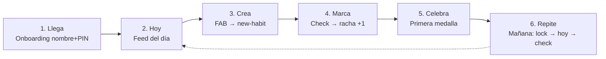

# Arquitectura de la Información — App Hábitos

> **Fase:** Producto y Flujos · **Paso 3** · Pulse Clay v1.0
> **Showcase interactivo:** [`Artefactos/documentacion/ArquitecturaInformacion/ARQUITECTURA_INFORMACION_VISUAL.html`](../../documentacion/ArquitecturaInformacion/ARQUITECTURA_INFORMACION_VISUAL.html)
> **Trazabilidad:** rutas de `ESTRUCTURA_DIRECTORIOS.md` · contratos de `CONTRATOS_API.md` · componentes del `manual-identidad-visual.md`

---

## 1. Sitemap — 16 puntos de navegación

```mermaid
flowchart TB
  subgraph ARR[Arranque · sin tab bar]
    OW[onboarding/welcome]
    OS[onboarding/security]
    ON[onboarding/notifications]
    LK[lock · overlay global]
  end
  subgraph TABS[Tabs principales]
    HY[(tabs)/hoy]
    PL[(tabs)/plan]
    LG[(tabs)/logros]
    PR[(tabs)/perfil]
  end
  subgraph DET[Detalles · stack]
    HD[habit/id]
    GD[goal/id]
    SS[settings/security]
    SD[settings/data]
  end
  subgraph SH[Sheets y modales]
    NH[modal/new-habit]
    NG[modal/new-goal]
    CI[modal/check-in]
    CE[modal/celebration]
  end
  OW --> OS --> ON --> HY
  LK --> HY
  HY --> HD
  PL --> GD
  PL --> HD
  PR --> SS
  PR --> SD
  HY --> NH
  HD --> NH
  PL --> NG
  GD --> NG
  HY --> CI
  HY --> CE
  CE --> LG
```

| Capa | Nodos | Rutas |
|---|---|---|
| Arranque | Bienvenida, PIN+Bio, Notificaciones, Lock | `onboarding/*`, `lock` |
| Tabs | Hoy, Plan, Logros, Perfil | `(tabs)/*` |
| Detalles (stack) | Hábito, Meta, Seguridad, Datos | `habit/[id]`, `goal/[id]`, `settings/*` |
| Sheets/modales | Nuevo hábito, Nueva meta, Check-in, Celebración | `modal/*` |

---

## 2. Reglas de navegación (R1–R9)

| # | Regla | Detalle |
|---|---|---|
| **R1** | Tab bar solo en tabs | Visible únicamente en Hoy/Plan/Logros/Perfil |
| **R2** | Detalles = stack con back | El back preserva scroll y estado de la tab de origen |
| **R3** | Crear = bottom sheet | Nunca pantalla dedicada; swipe-down cancela (con confirmación si hay datos) |
| **R4** | Lock global por AppState | App a background → overlay `lock`; solo `AuthRepository.unlock()` lo retira; 5 fallos → `RATE_LIMITED` |
| **R5** | Celebración no bloqueante | Modal 4 s con CTA → Logros; nunca interrumpe un `toggleLog` en curso |
| **R6** | FAB contextual | Solo en Hoy (nuevo hábito) y Plan (nueva meta); registro en ≤3 toques |
| **R7** | Onboarding es ida | Tras guardar el PIN no se vuelve atrás; cambio solo desde Perfil → Seguridad |
| **R8** | Reduce-motion | Fade 120 ms en sheets, sin «+1 🔥» animado, botón cerrar visible |
| **R9** | El error no navega | Fallo de BD/validación: permanecer en la pantalla con Toast + retry in-situ |

---

## 3. Trayectoria feliz (camino principal)



---

## 4. Correspondencia con el stack

| Elemento de navegación | Implementación |
|---|---|
| Tabs | `expo-router` — `(tabs)/` con tab bar de 64 px |
| Stack de detalles | Stack de expo-router sobre la tab activa |
| Sheets | Modales de expo-router + `@gorhom/bottom-sheet` (handle 36×4) |
| Overlay lock | Componente raíz controlado por listener de `AppState` |
| Modal celebración | Modal central con confeti Reanimated |
| Estado de navegación | Zustand para el estado de sesión; TanStack Query para datos |
