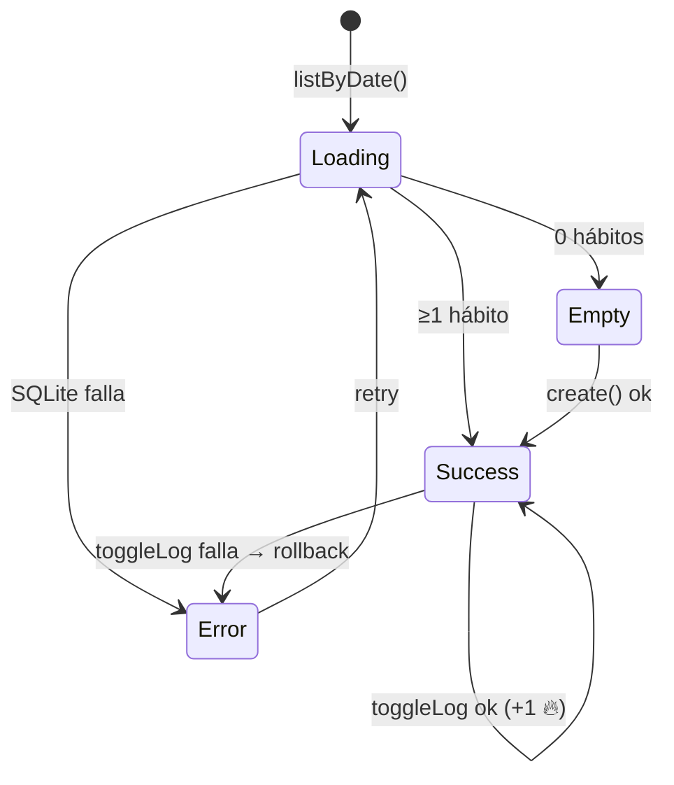
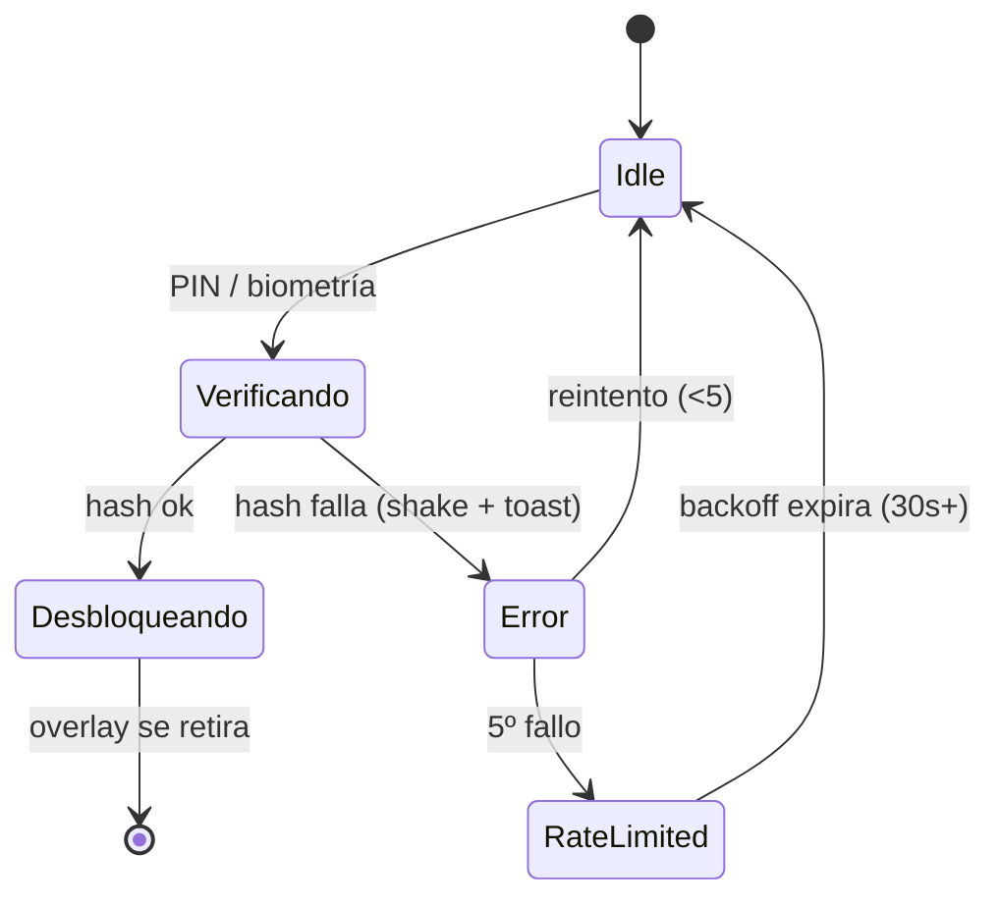

# Blueprints de Pantallas — App Hábitos

> **Fase:** Producto y Flujos · **Paso 4** · Pulse Clay v1.0
> **Showcase interactivo:** [`Artefactos/documentacion/Blueprints/BLUEPRINTS_VISUAL.html`](../../documentacion/Blueprints/BLUEPRINTS_VISUAL.html)
> **Cobertura:** 8 pantallas × 4 estados = **32 estados renderizados**. Componentes y curvas del `manual-identidad-visual.md`; repositorios de `CONTRATOS_API.md`.

---

## 1. Resumen de pantallas

| Pantalla | Ruta | Propósito | Datos clave |
|---|---|---|---|
| Hoy | `(tabs)/hoy` | Racha, progreso del día y checks | `listByDate`, `toggleLog` |
| Plan | `(tabs)/plan` | Hábitos no archivados + metas | `HABIT`, `GOAL` |
| Logros | `(tabs)/logros` | Racha, nivel, calendario, medallas | `ACHIEVEMENT*` |
| Perfil | `(tabs)/perfil` | Identidad, seguridad, datos | `USER_PROFILE`, `AuthRepository` |
| Lock | `lock` | Bloqueo global PIN/biometría | `unlockWithPin/Biometrics` |
| Nuevo hábito | `modal/new-habit` | Creación ≤60 s | `CreateHabitInput`, `create()` |
| Check-in | `modal/check-in` | Ánimo + energía (1–5) | `upsertEntry`, `WELL_ENTRY` |
| Celebración | `modal/celebration` | Medalla desbloqueada | `ACHIEVEMENT_UNLOCK` |

---

## 2. Mínimos por estado (los 4 obligatorios)

Toda pantalla implementa:

- **Loading** — `Skeleton` con shimmer (nunca pantalla en blanco); sheets muestran spinner en el CTA.
- **Empty** — `EmptyState` con blob clay y CTA secundario; sin StreakCard si no hay datos.
- **Success** — composición completa con `shadow-clay`, cifras `tabular-nums` y microinteracciones.
- **Error** — banner + `Toast` + retry in-situ (**R9: el error no navega**); rollback transaccional si aplica.

---

## 3. Estados críticos destacados

### Hoy — máquina de estados del feed

### Lock — ciclo de seguridad

---

## 4. Composición de referencia (Hoy · success)

| Zona | Componente DS | Datos |
|---|---|---|
| Top App Bar | Saludo + `Avatar` gradiente | `USER_PROFILE` |
| StreakCard | `Card clay` + cifra mono + chip Nivel | `STREAK_CACHE` |
| Progress | Track `#DDD5FB` → fill gradiente primary | cálculo 0–100 % |
| HabitCard ×N | Icono clay + `Check` 32 px | `HABIT_LOG` del día |
| FAB 56 px | Gradiente primary, `scale(.94)` al pulsar | abre `new-habit` |
| Tab Bar | 64 px, 4 tabs, activo primary | expo-router |

### Curvas de animación obligatorias

| Uso | Token |
|---|---|
| Check pop, progreso, cifras | `--ease-clay: cubic-bezier(.34,1.56,.64,1)` |
| Sheets, toasts, transiciones | `--ease-std: cubic-bezier(.2,.8,.2,1)` |
| Duraciones | press 120 · fast 180 · base 240 · sheet 320 · slow 400 ms |

---

## 5. Paleta de estados de componentes

| Estado | Valor |
|---|---|
| Botón primario disabled | `#C9BEFD` + texto `#8B84A6` |
| Input focus | borde `#6D4BF5` + halo `rgba(109,75,245,.15)` |
| Input error | borde `#DC2626` + fondo `#FEF2F2` |
| Toast éxito | check `#DCFCE7`/`#15803D` |
| Toast error | ✕ `#FEE2E2`/`#B91C1C` |
| Skeleton | `#EFEBFF` + shimmer blanco 1,3 s |
