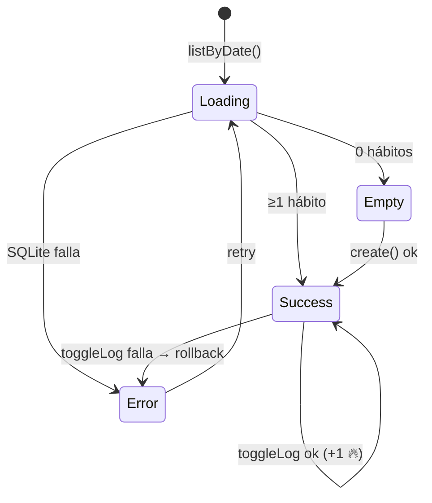
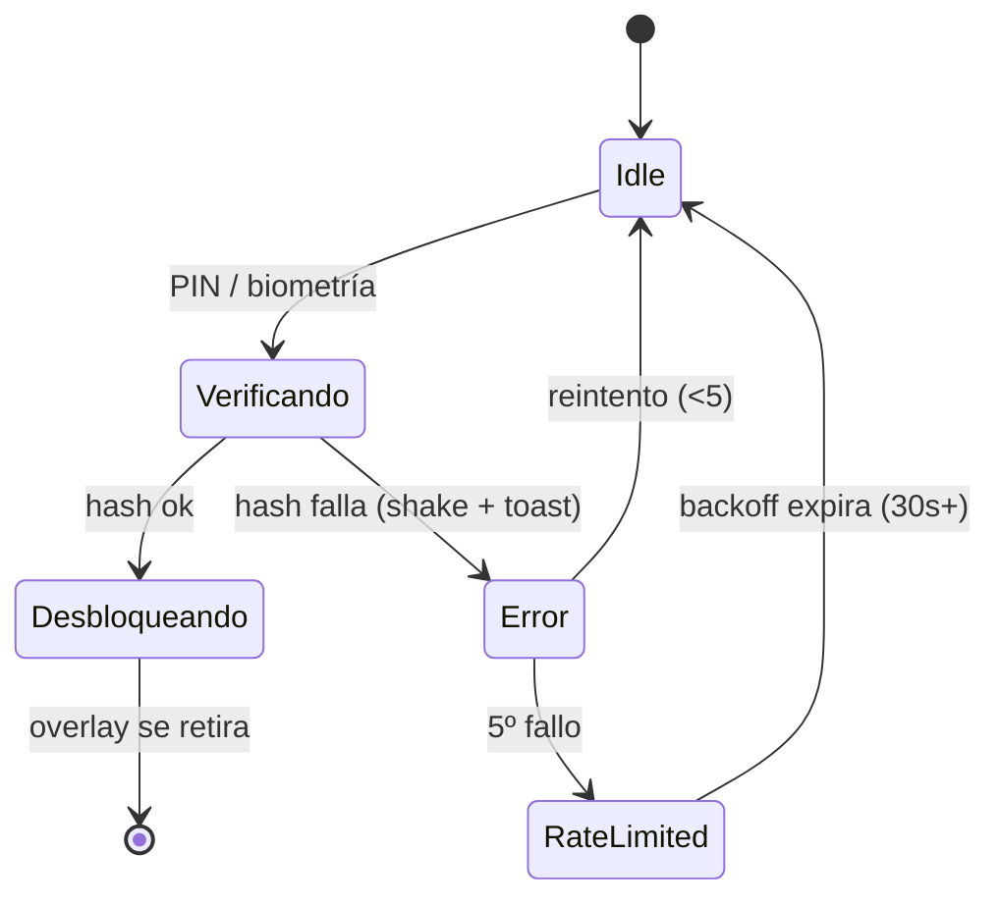
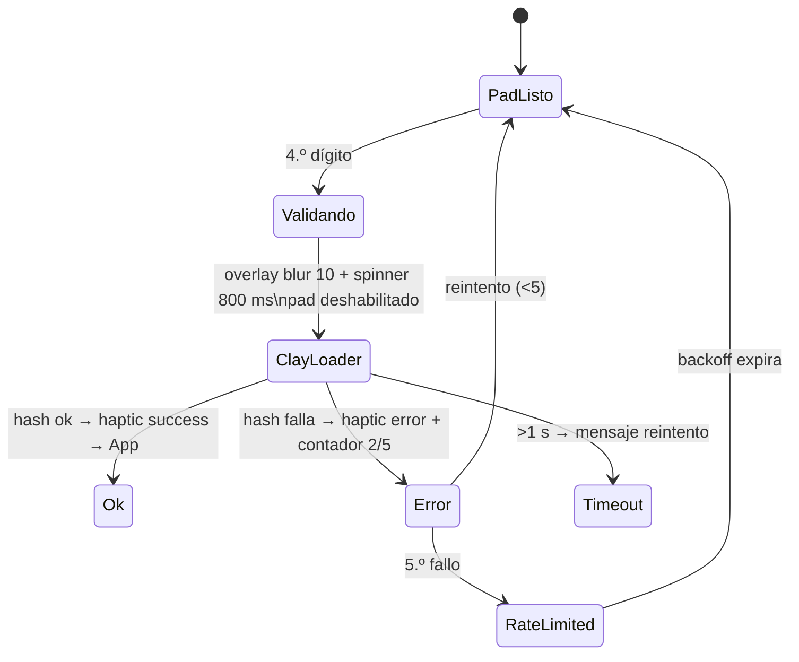
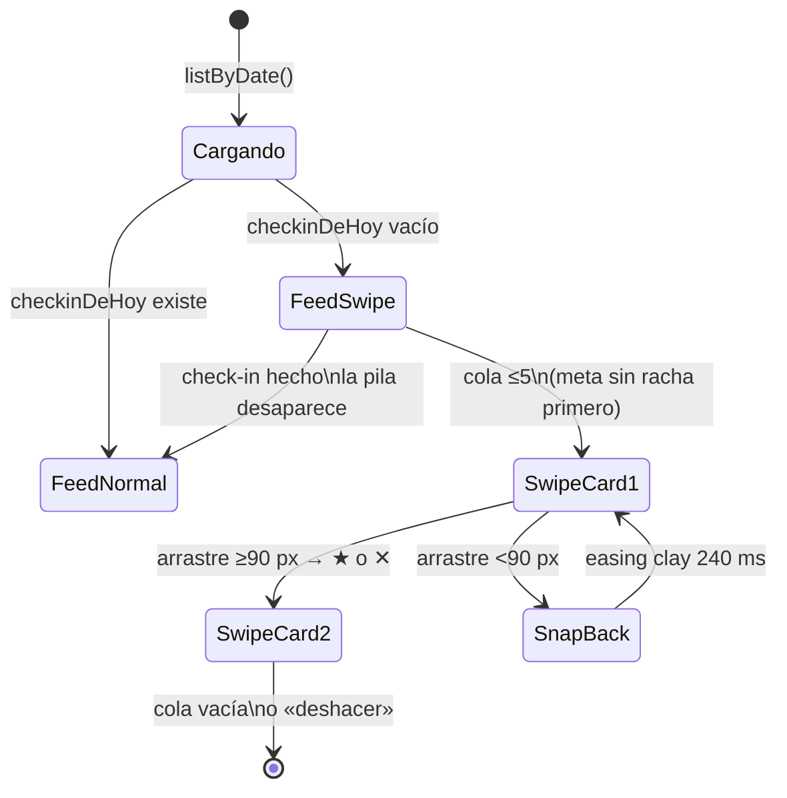

# Blueprints de Pantallas — App Hábitos

> **Fase:** Producto y Flujos · **Paso 4** · Pulse Clay v1.0
> **Showcase interactivo:** [`Artefactos/documentacion/Blueprints/BLUEPRINTS_VISUAL.html`](../../documentacion/Blueprints/BLUEPRINTS_VISUAL.html)
> **Cobertura:** 8 pantallas × 4 estados = **32 estados renderizados**. Componentes y curvas del `manual-identidad-visual.md`; repositorios de `CONTRATOS_API.md`.
>
> **Versión 2 (V2)** — **12 pantallas nuevas × 4 estados = 48 estados adicionales**. Storybook V2 con selector de estados: [`Blueprints/BLUEPRINTS_VISUAL.html`](../../Blueprints/BLUEPRINTS_VISUAL.html)

---

## 1. Resumen de pantallas

| Pantalla | Ruta | Propósito | Datos clave |
|---|---|---|---|
| Hoy | `(tabs)/hoy` | Racha, progreso del día y checks | `listByDate`, `toggleLog` |
| Plan | `(tabs)/plan` | Hábitos no archivados + metas | `HABIT`, `GOAL` |
| Logros | `(tabs)/logros` | Racha, nivel, calendario, medallas | `ACHIEVEMENT*` |
| Perfil | `(tabs)/perfil` | Identidad, seguridad, datos | `USER_PROFILE`, `AuthRepository` |
| Lock | `lock` | Bloqueo global PIN/biometría | `unlockWithPin/Biometrics` |
| Nuevo hábito | `modal/new-habit` | Creación ≤60 s | `CreateHabitInput`, `create()` |
| Check-in | `modal/check-in` | Ánimo + energía (1–5) | `upsertEntry`, `WELL_ENTRY` |
| Celebración | `modal/celebration` | Medalla desbloqueada | `ACHIEVEMENT_UNLOCK` |

### 1.1 Pantallas V2 (las 8 V1 anteriores quedan intactas)

| # | Pantalla V2 | Ruta | Propósito | Datos clave | HU |
|---|---|---|---|---|---|
| 9 | Perfil con foto | `(tabs)/perfil` | Avatar UUID + crédito git | `photo_uri`, `Linking` | HU-14/15 |
| 10 | Lock + ClayLoader | `lock` | Validación PIN visible | `validate()`, overlay blur | HU-16 |
| 11 | Hoy + Motivaciones | `(tabs)/hoy` | Pila swipeable condicional | `motivationQueueService` | HU-25 |
| 12 | Lista de hitos | `hitos/index` | Hitos con fotos | `milestoneRepository.list` | HU-18 |
| 13 | Detalle de hito | `hito/[id]` | Carrusel + comentarios | `ClayCarousel ≤10` | HU-18 |
| 14 | Crear hito | `modal/new-hito` | Nombre+fecha+ligazones+fotos | `create()` tx | HU-17 |
| 15 | Crear motivación | `modal/new-motivacion` | Texto ≤140 + trigger | `create()` | HU-24 |
| 16 | Crear medalla | `modal/new-logro` | Criterio + vínculos + umbral | `createCustom(is_custom=1)` | HU-21/22 |
| 17 | Mis logros | `(tabs)/logros` pestaña | Semillas + personalizadas | `achievement[]` | HU-23 |
| 18 | Meta con stats/notas | `goal/[id]` | Progreso + notas + día/hora | `stats_cache`, `GOAL_UPDATE` | HU-19/20 |
| 19 | Hábito con stats | `habit/[id]` | Tasa 30 d + hora pico + hitos | `getHabitStats` | HU-26 |

**Estados por pantalla (los 4 obligatorios, idénticos a V1):** Loading (`Skeleton`/spinner en CTA) · Empty (`EmptyState` + CTA) · Success (composición completa) · Error (retry in-situ, **R9**) — 12 × 4 = **48 estados nuevos renderizados en el storybook**.

### 1.2 Pantallas V2.1 de las mejoras aprobadas (HU-27…HU-30)

| Pantalla | Ruta | Estados clave | HU |
|---|---|---|---|
| Freeze en Logros | `(tabs)/logros` (sección racha) | Star ON/OFF + «1/2 este mes» / cuota agotada | HU-27 |
| Export/Import backup | `settings/data` (ampliación) | Sheet contraseña → progreso → éxito / `BACKUP_*` en pantalla | HU-28 |
| Compartir hito | acción en `hito/[id]` | Render 1080×1080 → share sheet / `SHARE_RENDER_FAILED` retry | HU-29 |
| Tramo horario | chips en `modal/new-habit` + orden en Hoy + filtro en stats | Seleccionado/deseleccionado; NULL al final | HU-30 |

---

## 2. Mínimos por estado (los 4 obligatorios)

Toda pantalla implementa:

- **Loading** — `Skeleton` con shimmer (nunca pantalla en blanco); sheets muestran spinner en el CTA.
- **Empty** — `EmptyState` con blob clay y CTA secundario; sin StreakCard si no hay datos.
- **Success** — composición completa con `shadow-clay`, cifras `tabular-nums` y microinteracciones.
- **Error** — banner + `Toast` + retry in-situ (**R9: el error no navega**); rollback transaccional si aplica.

---

## 3. Estados críticos destacados

### Hoy — máquina de estados del feed

### Lock — ciclo de seguridad

### 3.1 Lock V2 — el loader siempre visible (HU-16)

### 3.2 Hoy V2 — pila de motivaciones condicional (HU-25)

---

## 4. Composición de referencia (Hoy · success)

| Zona | Componente DS | Datos |
|---|---|---|
| Top App Bar | Saludo + `Avatar` gradiente | `USER_PROFILE` |
| StreakCard | `Card clay` + cifra mono + chip Nivel | `STREAK_CACHE` |
| Progress | Track `#DDD5FB` → fill gradiente primary | cálculo 0–100 % |
| HabitCard ×N | Icono clay + `Check` 32 px | `HABIT_LOG` del día |
| FAB 56 px | Gradiente primary, `scale(.94)` al pulsar | abre `new-habit` |
| Tab Bar | 64 px, 4 tabs, activo primary | expo-router |

### Curvas de animación obligatorias

| Uso | Token |
|---|---|
| Check pop, progreso, cifras | `--ease-clay: cubic-bezier(.34,1.56,.64,1)` |
| Sheets, toasts, transiciones | `--ease-std: cubic-bezier(.2,.8,.2,1)` |
| Duraciones | press 120 · fast 180 · base 240 · sheet 320 · slow 400 ms |

### 4.1 Composición de referencia V2 (Hoy con motivaciones · success)

| Zona | Componente DS | Datos |
|---|---|---|
| StreakCard | `Card clay` (V1 intacto) | `STREAK_CACHE` |
| SwipeCard | card clay 190 px + stamps ★/✕ | `motivationQueueService` |
| HabitCard ×N | V1 intacto | `HABIT_LOG` del día |
| Progress de meta | track `#DDD5FB` → fill gradiente + % | `GOAL.current_value` |
| FAB 56 px | V1 (hábito) | `modal/new-habit` |
| Tab Bar | V1 (4 tabs) | expo-router |

Tokens V2 en uso: `chartArea` = primary @12 % (fondo de gráficos **solo** en las vistas de stats); badges heredados de §5.

---

## 5. Paleta de estados de componentes

| Estado | Valor |
|---|---|
| Botón primario disabled | `#C9BEFD` + texto `#8B84A6` |
| Input focus | borde `#6D4BF5` + halo `rgba(109,75,245,.15)` |
| Input error | borde `#DC2626` + fondo `#FEF2F2` |
| Toast éxito | check `#DCFCE7`/`#15803D` |
| Toast error | ✕ `#FEE2E2`/`#B91C1C` |
| Skeleton | `#EFEBFF` + shimmer blanco 1,3 s |
