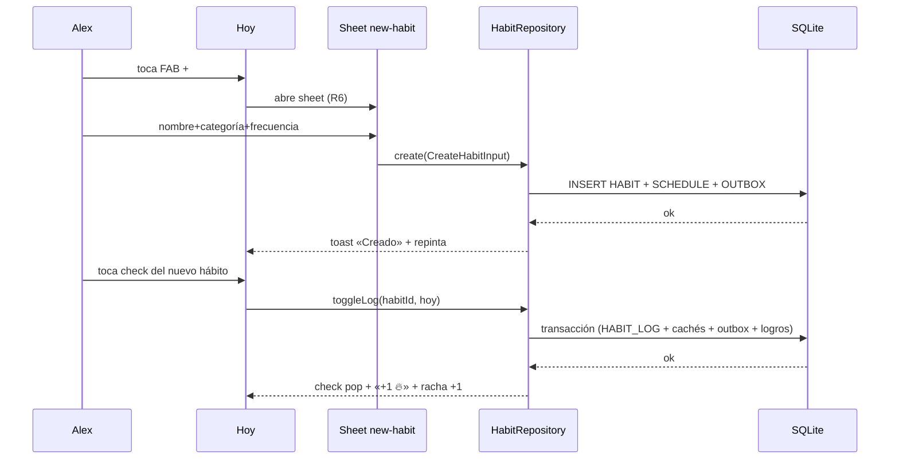
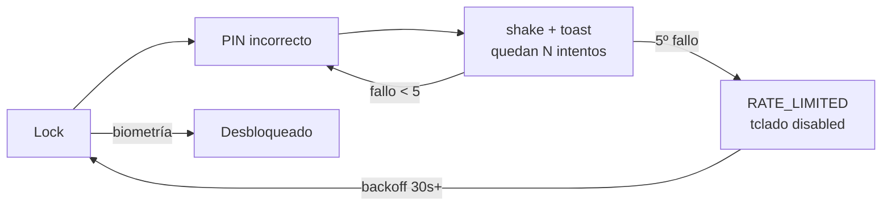

# Flujos de Usuario — App Hábitos

> **Fase:** Producto y Flujos · **Paso 5** · Pulse Clay v1.0
> **Showcase interactivo:** [`Artefactos/documentacion/Flujos/FLUJOS_VISUAL.html`](../../documentacion/Flujos/FLUJOS_VISUAL.html)
> **Trazabilidad:** contratos de `CONTRATOS_API.md` · reglas R1–R9 de `ARQUITECTURA_INFORMACION.md` · estados de los Blueprints.

---

## 1. Inventario de flujos

| # | Flujo | Tipo | Pasos | Historias |
|---|---|---|---|---|
| F1 | Primer arranque | ✅ Happy | 5 | HU-1…HU-5 |
| F2 | Crear hábito y marcarlo | ✅ Happy | 5 | HU-4, HU-6, HU-12 |
| F3 | Check-in de bienestar | ✅ Happy | 3 | HU-11 |
| F4 | Registrar progreso en meta | ✅ Happy | 3 | HU-9, HU-10 |
| F5 | Rutina de regreso | ✅ Happy | 4 | HU-6, R4 |
| F6 | PIN ×5 → bloqueo | ⛔ Crítico | 4 | HU-2 |
| F7 | Nombre inválido | ⚠ Alternativo | 3 | HU-4 |
| F8 | Fallo de BD al marcar | ⛔ Crítico | 4 | HU-6 |
| F9 | Check-in duplicado | ⚠ Alternativo | 3 | HU-11 |

---

## 2. Happy paths

### F2 · Crear hábito y marcarlo

### F4 · Registrar progreso en meta

1. Plan → chips «Metas» → toca «Leer 12 libros» (5/12) → stack `goal/[id]`.
2. `Stepper` +1 → **Registrar aporte** → `GoalRepository.addProgress(+1)`.
3. Transacción: `GOAL.current_value` + `GOAL_UPDATE`; barra al 50 % con `ease-clay`.
4. Si `current ≥ target` → estado `completed` + badge «Completada».

### F5 · Rutina de regreso

1. App a background → R4 arma el **lock** global.
2. PIN ok (scrypt) → overlay se retira con fade ease-clay 320 ms.
3. Marca los checks pendientes (hasta 3 por minuto).
4. `evaluateAndUnlock()` corre: si no hay criterio nuevo, **no hay modal** (R5).

---

## 3. Flujos alternativos y críticos

### F6 · PIN fallido ×5 → RATE_LIMITED

- El lock **nunca se evade**: el límite solo frena el teclado; la biometría es la salida legítima.
- Los intentos se registran en log local; nunca se envía el PIN por red.

### F8 · Fallo de BD al marcar (rollback)

1. Toca check → optimistic spinner.
2. SQLite lanza → **rollback total** (HABIT_LOG, STREAK_CACHE, OUTBOX intactos).
3. Check vuelve a vacío + toast rojo + banner «Reintentar» (R9: no se navega).
4. Reintento exitoso → racha +1 y toast success. El usuario nunca dudó de sus datos.

### F9 · Check-in duplicado (upsert)

1. Ya existe `WELL_ENTRY` de hoy → la mini-card reabre el sheet precargado.
2. Cambia valores → `upsertEntry()` detecta la fila por `entry_date` y la **actualiza**.
3. Cero error, cero duplicado: un día = un estado emocional en el calendario.

### F7 · Nombre inválido (Zod antes de la BD)

- CTA `disabled` (#C9BEFD) mientras `CreateHabitInput.name` sea inválido.
- Espacios → trim → estado error + helper «El nombre no puede estar vacío».
- Solo un nombre válido habilita `create()`.

---

## 4. Contratos tocados por flujo

| Flujo | Repositorios | Entidades | Errores posibles |
|---|---|---|---|
| F1 | `AuthRepository`, `USER_PROFILE` write | `USER_PROFILE` | `VALIDATION_ERROR` |
| F2 | `HabitRepository` | `HABIT`, `HABIT_LOG`, `STREAK_CACHE`, `OUTBOX` | `SQLITE_IOERR` (F8) |
| F3/F9 | `WellbeingRepository` | `WELL_ENTRY` | `SQLITE_CONSTRAINT` (mitigado por upsert) |
| F4 | `GoalRepository` | `GOAL`, `GOAL_UPDATE` | `VALIDATION_ERROR` |
| F5/F6 | `AuthRepository` | `SecureStore` | `RATE_LIMITED` |

---

## 5. Criterios de supervivencia (definición de hecho)

Un flujo está implementado cuando:

1. Cubre sus pasos happy path en dispositivo real (o Expo Go).
2. Su alternativo crítico (F6/F8) está implementado y pasa prueba manual.
3. Respeta R8: con `prefers-reduced-motion` activo, ningún paso depende de animación.
4. Ningún paso requiere conexión a internet.
