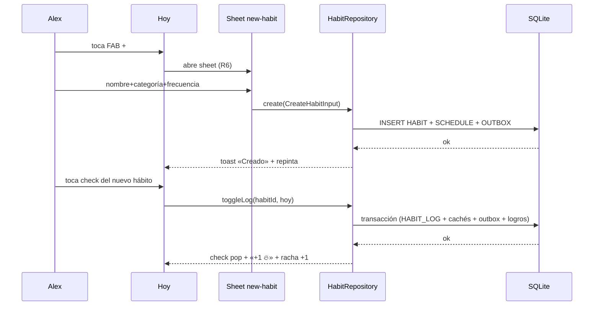
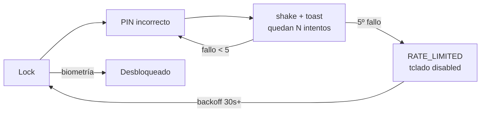
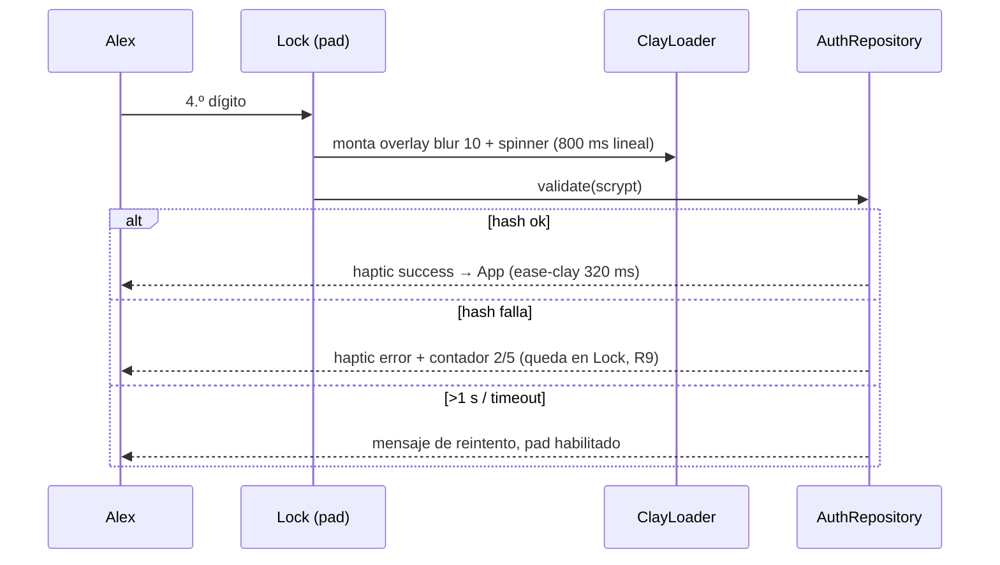

# Flujos de Usuario — App Hábitos

> **Fase:** Producto y Flujos · **Paso 5** · Pulse Clay v1.0
> **Showcase interactivo:** [`Artefactos/documentacion/Flujos/FLUJOS_VISUAL.html`](../../documentacion/Flujos/FLUJOS_VISUAL.html)
> **Trazabilidad:** contratos de `CONTRATOS_API.md` · reglas R1–R9 de `ARQUITECTURA_INFORMACION.md` · estados de los Blueprints.
>
> **Versión 2 (V2)** — flujos **F10–F19** con simulación jugable (happy + borde por flujo): [`Flujos/FLUJOS_VISUAL.html`](../../Flujos/FLUJOS_VISUAL.html)

---

## 1. Inventario de flujos

| # | Flujo | Tipo | Pasos | Historias |
|---|---|---|---|---|
| F1 | Primer arranque | ✅ Happy | 5 | HU-1…HU-5 |
| F2 | Crear hábito y marcarlo | ✅ Happy | 5 | HU-4, HU-6, HU-12 |
| F3 | Check-in de bienestar | ✅ Happy | 3 | HU-11 |
| F4 | Registrar progreso en meta | ✅ Happy | 3 | HU-9, HU-10 |
| F5 | Rutina de regreso | ✅ Happy | 4 | HU-6, R4 |
| F6 | PIN ×5 → bloqueo | ⛔ Crítico | 4 | HU-2 |
| F7 | Nombre inválido | ⚠ Alternativo | 3 | HU-4 |
| F8 | Fallo de BD al marcar | ⛔ Crítico | 4 | HU-6 |
| F9 | Check-in duplicado | ⚠ Alternativo | 3 | HU-11 |

### 1.1 Inventario V2 — F10…F19 (los F1–F9 V1 intactos)

| # | Flujo | Tipo | Modo borde | Historias |
|---|---|---|---|---|
| F10 | Foto de perfil | ✅ Happy | Permiso denegado → gradiente | HU-14 |
| F11 | Validación PIN visible | ✅ Happy | PIN incorrecto → backoff 30 s | HU-16 |
| F12 | Crear hito | ✅ Happy | Nombre vacío / 11.ª foto | HU-17 |
| F13 | Ver hito + carrusel | ✅ Happy | Sin imágenes / borrado con confirmación | HU-18 |
| F14 | Crear medalla | ✅ Happy | Sin vínculos / semilla bloqueada 🔒 | HU-21/22 |
| F15 | Desbloqueo de medalla | ✅ Happy | Sin umbral / evento duplicado → `[]` | HU-23 |
| F16 | Crear motivación | ✅ Happy | 141 caracteres / límite 50 | HU-24 |
| F17 | Motivación en Hoy | ✅ Happy | Con check-in → no aparece / <90 px snap | HU-25 |
| F18 | Stats de meta | ✅ Happy | Sin historial / error de `stats_cache` | HU-19/20 |
| F19 | Stats de hábito | ✅ Happy | <3 registros / error retry R9 | HU-26 |

### 1.2 Inventario V2.1 — F20…F23 (mejoras aprobadas)

| # | Flujo | Tipo | Borde | Historias |
|---|---|---|---|---|
| F20 | Racha con freeze | ✅ Happy | Cuota 2/2 agotada → `FREEZE_QUOTA_EXCEEDED` | HU-27 |
| F21 | Backup cifrado | ✅ Happy | Contraseña/archivo inválido → `BACKUP_*` (R9) | HU-28 |
| F22 | Hito compartible | ✅ Happy | Render fallido → `SHARE_RENDER_FAILED` retry | HU-29 |
| F23 | Horarios por hábito | ✅ Happy | Sin tramo → orden al final, stats sin filtro | HU-30 |

---

## 2. Happy paths

### F2 · Crear hábito y marcarlo



### F4 · Registrar progreso en meta

1. Plan → chips «Metas» → toca «Leer 12 libros» (5/12) → stack `goal/[id]`.
2. `Stepper` +1 → **Registrar aporte** → `GoalRepository.addProgress(+1)`.
3. Transacción: `GOAL.current_value` + `GOAL_UPDATE`; barra al 50 % con `ease-clay`.
4. Si `current ≥ target` → estado `completed` + badge «Completada».

### F5 · Rutina de regreso

1. App a background → R4 arma el **lock** global.
2. PIN ok (scrypt) → overlay se retira con fade ease-clay 320 ms.
3. Marca los checks pendientes (hasta 3 por minuto).
4. `evaluateAndUnlock()` corre: si no hay criterio nuevo, **no hay modal** (R5).

---

## 3. Flujos alternativos y críticos

### F6 · PIN fallido ×5 → RATE_LIMITED



- El lock **nunca se evade**: el límite solo frena el teclado; la biometría es la salida legítima.
- Los intentos se registran en log local; nunca se envía el PIN por red.

### F8 · Fallo de BD al marcar (rollback)

1. Toca check → optimistic spinner.
2. SQLite lanza → **rollback total** (HABIT_LOG, STREAK_CACHE, OUTBOX intactos).
3. Check vuelve a vacío + toast rojo + banner «Reintentar» (R9: no se navega).
4. Reintento exitoso → racha +1 y toast success. El usuario nunca dudó de sus datos.

### F9 · Check-in duplicado (upsert)

1. Ya existe `WELL_ENTRY` de hoy → la mini-card reabre el sheet precargado.
2. Cambia valores → `upsertEntry()` detecta la fila por `entry_date` y la **actualiza**.
3. Cero error, cero duplicado: un día = un estado emocional en el calendario.

### F7 · Nombre inválido (Zod antes de la BD)

- CTA `disabled` (#C9BEFD) mientras `CreateHabitInput.name` sea inválido.
- Espacios → trim → estado error + helper «El nombre no puede estar vacío».
- Solo un nombre válido habilita `create()`.

---

## 3.1 Flujos V2 — detalle (F10…F19)

### F11 · Validación PIN visible (HU-16)



### F17 · Motivaciones en Hoy (HU-25) — cola condicional

1. Abrir Hoy → `motivationQueueService.peek()`: si `checkinDeHoy` **existe** → sin pila (racha en marcha).
2. Sin check-in → cola ≤5 (ligadas a meta sin racha primero; excluye `MOTIVATION_SHOW` de hoy).
3. Swipe ≥90 px: → ★ guardar / ← ✕ descartar; avanza con remoción animada. <90 px → snap back `ease-clay`.
4. «Deshacer» revierte la última; reduced-motion sustituye la rotación por botones accesibles.
5. Al hacer check-in del día, la pila restante desaparece del flujo (R11).

### F12 · Crear hito transaccional (HU-17)

```mermaid
flowchart LR
  A[new-hito\nformSheet] --> B{Zod\nnombre 1-80\n≥1 ligazón\n≤10 fotos}
  B -->|inválido| C[CTA disabled\nhelper en español]
  B -->|válido| D[milestoneRepository.create\ntx: hito + imágenes + links]
  D -->|ok| E[lista + nueva MilestoneCard]
  D -->|fallo| F[rollback + toast\n(R9)]
```

### F15 · Desbloqueo idempotente (HU-23)

1. `toggleLog`/`addProgress` → evento de dominio → `evaluateEvent` (criterios `habit_ids[]`, `goal_ids[]`, `mode any|all`).
2. Umbral cumplido → `UNIQUE(user, achievement)` garantiza unlock **una sola vez** → `CelebrationWatcher` (R5).
3. Repetir el evento o duplicarlo → `evaluateEvent → []` → **sin segundo modal, sin error**.

### Bordes V2 rápidos

- **F10**: permiso denegado → error con enlace a Ajustes + «Usar gradiente» (avatar V1 intacto).
- **F13**: hito sin imágenes → vista de texto con CTA; borrar → confirmación `Alert` + limpieza de `FileSystem`.
- **F14**: semilla editada → bloqueada (`is_custom=0`); sin vínculos → CTA `disabled`.
- **F16**: 141.º carácter → contador rojo + CTA off; 50/50 motivaciones → error «Límite».
- **F18**: `stats_cache` corrupta → error + retry → `recompute` transaccional.
- **F19**: <3 registros → empty «pocos datos»; error → retry in-situ (R9).

---

## 4. Contratos tocados por flujo

| Flujo | Repositorios | Entidades | Errores posibles |
|---|---|---|---|
| F1 | `AuthRepository`, `USER_PROFILE` write | `USER_PROFILE` | `VALIDATION_ERROR` |
| F2 | `HabitRepository` | `HABIT`, `HABIT_LOG`, `STREAK_CACHE`, `OUTBOX` | `SQLITE_IOERR` (F8) |
| F3/F9 | `WellbeingRepository` | `WELL_ENTRY` | `SQLITE_CONSTRAINT` (mitigado por upsert) |
| F4 | `GoalRepository` | `GOAL`, `GOAL_UPDATE` | `VALIDATION_ERROR` |
| F5/F6 | `AuthRepository` | `SecureStore` | `RATE_LIMITED` |
| **F10** | `ProfileRepository` + `imageStore` | `USER_PROFILE.photo_uri` | permiso denegado, mime/2 MB |
| **F11** | `AuthRepository.validate()` | `SecureStore` hash | `RATE_LIMITED`, timeout >1 s |
| **F12/F13** | `MilestoneRepository` | `MILESTONE`, `MILESTONE_IMAGE`, `MILESTONE_LINK` | límite 10 fotos, `SQLITE_IOERR` |
| **F14/F15** | `AchievementRepository` | `ACHIEVEMENT(is_custom)`, `ACHIEVEMENT_UNLOCK` | sin vínculos, unlock duplicado |
| **F16/F17** | `MotivationRepository` + `motivationQueueService` | `MOTIVATION`, `MOTIVATION_SHOW` | límite 50, cola vacía |
| **F18/F19** | `GoalRepository`/`HabitRepository` stats | `stats_cache`, `GOAL_UPDATE` | cache corrupta → `recompute` |

---

## 5. Criterios de supervivencia (definición de hecho)

Un flujo está implementado cuando:

1. Cubre sus pasos happy path en dispositivo real (o Expo Go).
2. Su alternativo crítico (F6/F8) está implementado y pasa prueba manual.
3. Respeta R8: con `prefers-reduced-motion` activo, ningún paso depende de animación.
4. Ningún paso requiere conexión a internet.

### Criterios V2 adicionales (F10…F19)

5. **F11:** el `ClayLoader` es visible durante toda la validación — ninguna pantalla parece congelada (HU-16); con reduced-motion el spinner queda como frame estático.
6. **F12/F13:** crear/borrar hito es transaccional y limpia `FileSystem` (nada de huérfanos).
7. **F15:** `evaluateEvent` idempotente verificado con evento repetido (segundo `[]`).
8. **F17:** con check-in hecho hoy, la pila **no aparece** (R11) y la pestaña Hoy sigue siendo usable con teclado/lector (botones + deshacer).
9. **Todos:** los 4 estados por pantalla (Loading/Empty/Success/Error-R9) implementados y citados en el storybook V2.
