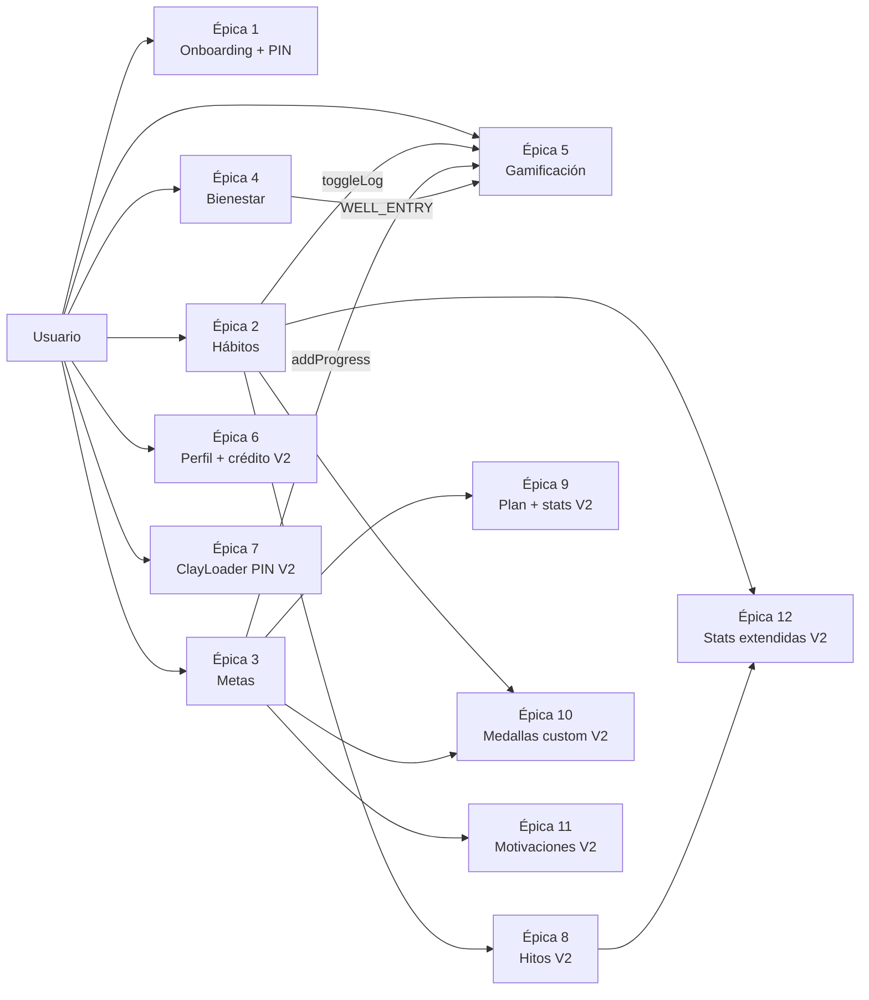

# Requerimientos Funcionales — App Hábitos

> **Fase:** Producto y Flujos · **Paso 2** · Pulse Clay v1.0
> **Showcase interactivo:** [`Artefactos/documentacion/Requerimientos/REQUERIMIENTOS_VISUAL.html`](../../documentacion/Requerimientos/REQUERIMIENTOS_VISUAL.html)
> **Trazabilidad:** `manual-identidad-visual.md` (DS) · `MODELO_DE_DATOS.md` (entidades) · `CONTRATOS_API.md` (repositorios)
>
> **Versión 2 (V2)** — Épicas 6–12 · HU-14…HU-26 aprobadas. Showcase V2: [`Requerimientos/REQUERIMIENTOS_VISUAL.html`](../../Requerimientos/REQUERIMIENTOS_VISUAL.html)

---

## 1. Actores

El MVP local-first tiene un **único rol**: el usuario del dispositivo (sin RBAC; la sync multiusuario es Fase 2, ADR-001).

### Persona principal: Alex Rivera

| Atributo | Valor |
|---|---|
| Edad | 24 años |
| Perfil | Joven profesional digital nativo |
| Objetivo | Constatar hábitos sin fricción; ver racha y progreso sin navegar |
| Frustraciones | Apps con cuenta obligatoria, interfaces frías, rachas perdidas por bugs de registro |
| Cita | «Solo quiero abrir la app, tocar una vez y sentir que avanzo. Sin cuentas, sin esperar a que cargue.» |

### Estados vitales del actor

| Estado | Condición | Pantalla |
|---|---|---|
| Nuevo | Sin `USER_PROFILE` | Onboarding (HU-1…HU-3) |
| Activo | Sesión local desbloqueada | Tabs Hoy/Plan/Logros/Perfil |
| Protegido | App vino de background | Lock (PIN/biometría) |

---

## 2. Épicas

| Épica | Título | Historias |
|---|---|---|
| 1 | Onboarding y protección | HU-1, HU-2, HU-3 |
| 2 | Gestión de hábitos | HU-4 … HU-8 |
| 3 | Metas personales | HU-9, HU-10 |
| 4 | Bienestar diario | HU-11 |
| 5 | Gamificación | HU-12, HU-13 |
| **6** | **Perfil personalizado y crédito** *(V2)* | HU-14, HU-15 |
| **7** | **Validación visible del PIN** *(V2)* | HU-16 |
| **8** | **Hitos** *(V2)* | HU-17, HU-18 |
| **9** | **Plan enriquecido: progreso, notas y estadísticas** *(V2)* | HU-19, HU-20 |
| **10** | **Logros y medallas personalizados** *(V2)* | HU-21 … HU-23 |
| **11** | **Motivaciones descartables** *(V2)* | HU-24, HU-25 |
| **12** | **Estadísticas extendidas (hábito e hito)** *(V2)* | HU-26 |

---

## 3. Historias de usuario y criterios de aceptación

Formato: **Como…, quiero…, para…**. Los criterios son reglas inquebrantables heredadas de la arquitectura.

### Épica 1 — Onboarding y protección

**HU-1 · Crear perfil local** *(Must)*
Como usuario nuevo quiero ingresar mi nombre y elegir mi avatar para personalizar la app sin crear una cuenta.

- Given sin perfil, When abro la app, Then veo el sheet de bienvenida con `USER_PROFILE` vacío.
- Given nombre de 1–40 caracteres válido, When confirmo, Then se inserta `USER_PROFILE` con `avatar_seed` aleatorio y entro a «Hoy».
- Given nombre vacío o >40, Then el botón primario permanece `disabled` (`#C9BEFD`).

**HU-2 · Configurar PIN y biometría** *(Must)*
Como usuario quiero proteger la app con PIN de 6 dígitos y desbloqueo biométrico.

- Given el PIN, Then se guarda **solo como hash scrypt** en `SecureStore` — nunca en SQLite.
- Given 5 fallos consecutivos, Then `RATE_LIMITED` con backoff exponencial y toast de error.
- Given biometría disponible, Then `AuthRepository.unlockWithBiometrics()` y transición `ease-clay` 320 ms a «Hoy».

**HU-3 · Notificaciones opcionales** *(Should)*
- Given el onboarding final, When elijo «Activar», Then solicito permiso del sistema (único permiso de la app).
- Given permiso denegado, Then la app continúa y guarda la preferencia en `MMKV`.

### Épica 2 — Gestión de hábitos

**HU-4 · Crear un hábito** *(Must)*
- Given el FAB «+», Then abre el bottom sheet `new-habit` con `ClayInput` y chips de categoría.
- Given datos válidos según `CreateHabitInput` (Zod), Then `HabitRepository.create()` inserta y cierra con toast.
- Given nombre vacío, Then `VALIDATION_ERROR` → input en estado error + helper.

**HU-5 · Ver el feed «Hoy»** *(Must)*
- Given sesión desbloqueada, Then `HabitRepository.listByDate(hoy)` pinta `StreakCard` + `HabitCard` + `Progress`.
- Given 0 hábitos, Then `EmptyState` con blob y CTA «Crear hábito».
- Given lectura en curso, Then 3 `Skeleton` con shimmer — nunca pantalla en blanco.

**HU-6 · Marcar o desmarcar un hábito** *(Must)*
- Given el check, When toco, Then `toggleLog` en **transacción**: upsert `HABIT_LOG` + recalc caché + outbox + evaluación de logros.
- Then pop `ease-clay` + «+1 🔥» flotante + incremento mono de racha + toast 4 s.
- Given toque accidental, Then toggle inverso; la BD prohíbe doble log por `UNIQUE(habit_id, log_date)`.
- Given fallo de BD, Then **rollback completo** + toast «No se pudo guardar».

**HU-7 · Editar o archivar** *(Should)* — `is_archived=true` (soft); eliminar con confirmación y botón peligro.
**HU-8 · Ver historial** *(Could)* — `getHistory(from,to)` → calendario con día activo pill primary.

### Épica 3 — Metas

**HU-9 · Crear meta** *(Must)* — sheet `new-goal` con `Stepper`; objetivo ≤ 0 → `VALIDATION_ERROR`.
**HU-10 · Registrar progreso** *(Must)* — `GoalRepository.addProgress` actualiza `current_value` + `GOAL_UPDATE` en la misma transacción; `current ≥ target` → estado `completed` + badge.

### Épica 4 — Bienestar

**HU-11 · Check-in diario** *(Must)* — mood/energía 1–5; `WellbeingRepository.upsertEntry`; **máx. 1 entrada por día** (`UNIQUE entry_date`); repetir el día actualiza, no duplica.

### Épica 5 — Gamificación

**HU-12 · Racha y progreso** *(Must)* — `STREAK_CACHE`/`HABIT_STREAK_CACHE` en O(1); cifras `font-mono tabular-nums` con pop.
**HU-13 · Medallas** *(Should)* — `AchievementRepository.evaluateAndUnlock` idempotente (`UNIQUE`); unlock abre sheet de celebración; jamás revierte un check ya hecho.

### Épica 6 — Perfil personalizado y crédito *(V2)*

**HU-14 · Añadir foto de perfil y ver crédito** *(Must)*

- Given en Perfil, When toco el badge 📷, Then abre galería/cámara con permiso explicado; Given imagen ≤2 MB válida, Then se recorta en círculo, se guarda como UUID en `FileSystem` + `user_profiles.photo_uri`.
- Given error de permiso, Then estado de error con enlace a ajustes y avatar sin foto intacto (gradiente con iniciales, nunca un hueco roto).
- Given en Perfil, Then aparece «Desarrollado para y por Uskein» y el enlace `github.com/uskein/habitos` abre en el navegador nativo (`Linking.openURL`).

**HU-15 · Crédito y repositorio** *(Should)* — ver HU-14 (crédito): visible en Perfil sin scroll colapsado; enlace externo con confirmación nativa.

### Épica 7 — Validación visible del PIN *(V2)*

**HU-16 · Loader de validación** *(Must)*

- Given el 4.º dígito, When se dispara la validación, Then aparece `ClayLoader` (overlay blur 10 + spinner 800 ms lineal + «Validando…») con el pad visible deshabilitado.
- Given respuesta < 1 s, Then sale con haptic success/error; Given timeout, Then sale con mensaje de reintento.
- Given `useReducedMotion() = true`, Then el spinner se congela en un frame estático y el texto permanece.

### Épica 8 — Hitos *(V2)*

**HU-17 · Crear hito** *(Must)*

- Given el sheet `new-hito`, When completo nombre ≤80 + fecha + ≥1 ligazón + ≤10 imágenes, Then `milestoneRepository.create()` persiste transaccionalmente hito+imágenes+links.
- Given nombre vacío, Then CTA deshabilitado (Zod); Given 11.ª imagen, Then error «Límite (10)».

**HU-18 · Ligar y navegar hitos** *(Must)*

- Given chips de hábitos y metas, Then el hito guarda `entity_type ∈ {habit, goal}` por cada selección y aparece en ambos detalles.
- Given ≥2 imágenes, Then `ClayCarousel` con snap 320 ms, dots y contador «n/t»; 1 imagen → sin carrusel.
- Given texto ≤500, When comento, Then el comentario se muestra en la `MilestoneCard` con fecha mono; al borrar el hito, las imágenes se eliminan de `FileSystem`.

### Épica 9 — Plan enriquecido: progreso, notas y estadísticas *(V2)*

**HU-19 · Progreso + notas por meta** *(Must)*

- Given una meta en Plan, Then su card muestra barra de progreso (track/fill DS) y cantidad.
- Given en `goal/[id]`, Then puedo añadir/editar notas con guardado en la misma transacción `GOAL_UPDATE`.

**HU-20 · Stats día/hora de meta** *(Should)*

- Given la meta, Then `ClayBars` muestra cumplimiento por día (7 barras) y por hora pico.
- Given datos vacíos, Then estado empty con CTA; Given error de caché, Then retry in-situ (R9).

### Épica 10 — Logros y medallas personalizados *(V2)*

**HU-21 · Crear medalla** *(Must)*

- Given el sheet `new-logro`, When nombre + emoji + criterio + ≥1 vínculo + umbral ≥1, Then se crea con `is_custom = 1`.
- Given criterio sin vínculos, Then validación Zod y CTA deshabilitado.

**HU-22 · Ligazón hábito/meta** *(Must)* — Given tipo hábito/meta/ambos, Then `criteria.habit_ids/goal_ids` con `mode any|all`; modo «ambos» solo desbloquea al cumplir ambos conjuntos.

**HU-23 · Evaluación y gestión** *(Should)*

- Given check-in o cierre de meta, Then `evaluateEvent` desbloquea de forma idempotente (nunca 2 veces) y notifica con `CelebrationWatcher` (R5).
- Given `progress_style`, Then la medalla muestra barra/nivel/oculto; Given seed V1, Then `is_custom=0` y jamás editable/borrable.
- Given medalla propia, Then puedo editar o eliminar con confirmación; si está desbloqueada conserva su fecha al editar el texto.

### Épica 11 — Motivaciones descartables *(V2)*

**HU-24 · Crear motivación** *(Should)* — Given texto ≤140 + emoji + meta opcional + disparador (`no_streak|morning|missed_day`), Then se persiste y la preview muestra la card swipeable real; límite 50 por usuario.

**HU-25 · Disparo y swipe en Hoy** *(Should)*

- Given hoy sin check-in, When abro Hoy, Then `motivationQueueService` encola hasta 5 (ligadas a meta sin racha primero); Given ya hay check-in hoy, Then **no se muestra ninguna**.
- Given la pila, When arrastro → guardar (★); ← descartar; Given <90 px, Then vuelve al centro con easing clay; reduced-motion → sin rotación, siempre con botones accesibles y «deshacer».
- Given una motivación ya mostrada hoy, Then `MOTIVATION_SHOW` la excluye de la cola del día.

### Épica 12 — Estadísticas extendidas *(V2)*

**HU-26 · Stats de hábito y hito** *(Should)*

- Given un hábito, Then `getHabitStats` sirve tasa 30 días (`ClayBars`), distribución por hora (Victory) y tendencia (`ClaySparkline`) desde `stats_cache`.
- Given un hito ligado, Then se muestra la actividad de hábito/meta en la semana del hito (antes/después).

### Mejoras V2.1 seleccionadas *(aprobadas 2026-10-10)*

**HU-27 · Racha con freeze** *(Should — Épica 5)*

- Given 2 freezes disponibles al mes, When una racha se rompería, Then el sistema consume 1 freeze automáticamente y lo notifica en `StreakCard`.
- Given el botón ⭐ en Logros, Then puedo activar/desactivar el freeze manual con confirmación y ver «1/2 este mes».
- Given cuota agotada (`FREEZE_QUOTA_EXCEEDED`), Then se informa y la racha sigue su curso normal.

**HU-28 · Backup cifrado** *(Should — Épica 6/Datos)*

- Given Perfil → Datos, When exporto, Then se genera un archivo JSON cifrado (contraseña elegida por el usuario) que incluye hábitos, metas, logs, logros, hitos y **fotos**.
- Given un archivo y su contraseña, When importo, Then validación Zod completa previa → transacción con rollback → la app queda en el estado importado; contraseña o archivo inválidos → `BACKUP_PASSWORD_INVALID`/`BACKUP_CORRUPT` en la pantalla (R9).

**HU-29 · Hito compartible** *(Could — Épica 8)*

- Given un hito con ≥1 imagen, When toco «Compartir», Then se renderiza una tarjeta 1080×1080 (gradiente Pulse Clay + foto + nombre + fecha + crédito) y se abre el sheet nativo de compartir (`expo-sharing`).
- Given fallo de render, Then `SHARE_RENDER_FAILED` con retry in-situ (R9).

**HU-30 · Horarios por hábito** *(Should — Épica 2)*

- Given `new-habit`, Then puedo elegir tramo (mañana/tarde/noche) o ninguno; `timeSlot` es opcional.
- Given hábitos con tramo, Then «Hoy» los ordena por tramo (sin tramo al final); Given stats, Then filtro por tramo en día y hora.

---

## 4. Reglas de negocio transversales

1. **Local-first:** ninguna escritura depende de red.
2. **Transaccionalidad:** `toggleLog` y `addProgress` son atómicos (rollback ante fallo).
3. **Idempotencia:** log por día y unlock de medalla son únicos por restricción de BD.
4. **El error no navega:** toast + retry in-situ.
5. **Movimiento:** si `prefers-reduced-motion`, las microinteracciones se sustituyen por cambios de estado inmediatos.

### Reglas nuevas V2 (heredan 1–5)

6. **Imágenes fuera de SQLite:** los binarios viven en `FileSystem.documentDirectory` con nombre UUID; SQLite solo guarda rutas (≤250 KB avatar, ≤2 MB/hito) — previene path-traversal y crecimiento de la BD.
7. **`evaluateEvent` puro e idempotente:** evaluación extensiva de criterios (`habit_ids[]`, `goal_ids[]`, `mode any|all`) tras cada evento de dominio; un unlock jamás se repite (`UNIQUE(user, achievement)`).
8. **Motivaciones no bloquean:** la pila swipe solo aparece cuando `checkinDeHoy` está vacío y nunca cubre el contenido principal de Hoy.
9. **Feedback siempre visible:** toda operación >200 ms muestra estado (ClayLoader en validación PIN, spinner en CTA de sheets) — la app nunca parece congelada.
10. **Medallas semilla inmutables:** `is_custom=0` jamás se edita ni se borra; las propias (`is_custom=1`) requieren confirmación en borrado.
