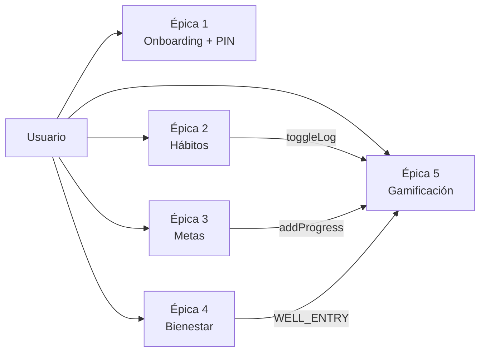

# Requerimientos Funcionales — App Hábitos

> **Fase:** Producto y Flujos · **Paso 2** · Pulse Clay v1.0
> **Showcase interactivo:** [`Artefactos/documentacion/Requerimientos/REQUERIMIENTOS_VISUAL.html`](../../documentacion/Requerimientos/REQUERIMIENTOS_VISUAL.html)
> **Trazabilidad:** `manual-identidad-visual.md` (DS) · `MODELO_DE_DATOS.md` (entidades) · `CONTRATOS_API.md` (repositorios)

---

## 1. Actores

El MVP local-first tiene un **único rol**: el usuario del dispositivo (sin RBAC; la sync multiusuario es Fase 2, ADR-001).

### Persona principal: Alex Rivera

| Atributo | Valor |
|---|---|
| Edad | 24 años |
| Perfil | Joven profesional digital nativo |
| Objetivo | Constatar hábitos sin fricción; ver racha y progreso sin navegar |
| Frustraciones | Apps con cuenta obligatoria, interfaces frías, rachas perdidas por bugs de registro |
| Cita | «Solo quiero abrir la app, tocar una vez y sentir que avanzo. Sin cuentas, sin esperar a que cargue.» |

### Estados vitales del actor

| Estado | Condición | Pantalla |
|---|---|---|
| Nuevo | Sin `USER_PROFILE` | Onboarding (HU-1…HU-3) |
| Activo | Sesión local desbloqueada | Tabs Hoy/Plan/Logros/Perfil |
| Protegido | App vino de background | Lock (PIN/biometría) |

---

## 2. Épicas

| Épica | Título | Historias |
|---|---|---|
| 1 | Onboarding y protección | HU-1, HU-2, HU-3 |
| 2 | Gestión de hábitos | HU-4 … HU-8 |
| 3 | Metas personales | HU-9, HU-10 |
| 4 | Bienestar diario | HU-11 |
| 5 | Gamificación | HU-12, HU-13 |

---

## 3. Historias de usuario y criterios de aceptación

Formato: **Como…, quiero…, para…**. Los criterios son reglas inquebrantables heredadas de la arquitectura.

### Épica 1 — Onboarding y protección

**HU-1 · Crear perfil local** *(Must)*
Como usuario nuevo quiero ingresar mi nombre y elegir mi avatar para personalizar la app sin crear una cuenta.

- Given sin perfil, When abro la app, Then veo el sheet de bienvenida con `USER_PROFILE` vacío.
- Given nombre de 1–40 caracteres válido, When confirmo, Then se inserta `USER_PROFILE` con `avatar_seed` aleatorio y entro a «Hoy».
- Given nombre vacío o >40, Then el botón primario permanece `disabled` (`#C9BEFD`).

**HU-2 · Configurar PIN y biometría** *(Must)*
Como usuario quiero proteger la app con PIN de 6 dígitos y desbloqueo biométrico.

- Given el PIN, Then se guarda **solo como hash scrypt** en `SecureStore` — nunca en SQLite.
- Given 5 fallos consecutivos, Then `RATE_LIMITED` con backoff exponencial y toast de error.
- Given biometría disponible, Then `AuthRepository.unlockWithBiometrics()` y transición `ease-clay` 320 ms a «Hoy».

**HU-3 · Notificaciones opcionales** *(Should)*
- Given el onboarding final, When elijo «Activar», Then solicito permiso del sistema (único permiso de la app).
- Given permiso denegado, Then la app continúa y guarda la preferencia en `MMKV`.

### Épica 2 — Gestión de hábitos

**HU-4 · Crear un hábito** *(Must)*
- Given el FAB «+», Then abre el bottom sheet `new-habit` con `ClayInput` y chips de categoría.
- Given datos válidos según `CreateHabitInput` (Zod), Then `HabitRepository.create()` inserta y cierra con toast.
- Given nombre vacío, Then `VALIDATION_ERROR` → input en estado error + helper.

**HU-5 · Ver el feed «Hoy»** *(Must)*
- Given sesión desbloqueada, Then `HabitRepository.listByDate(hoy)` pinta `StreakCard` + `HabitCard` + `Progress`.
- Given 0 hábitos, Then `EmptyState` con blob y CTA «Crear hábito».
- Given lectura en curso, Then 3 `Skeleton` con shimmer — nunca pantalla en blanco.

**HU-6 · Marcar o desmarcar un hábito** *(Must)*
- Given el check, When toco, Then `toggleLog` en **transacción**: upsert `HABIT_LOG` + recalc caché + outbox + evaluación de logros.
- Then pop `ease-clay` + «+1 🔥» flotante + incremento mono de racha + toast 4 s.
- Given toque accidental, Then toggle inverso; la BD prohíbe doble log por `UNIQUE(habit_id, log_date)`.
- Given fallo de BD, Then **rollback completo** + toast «No se pudo guardar».

**HU-7 · Editar o archivar** *(Should)* — `is_archived=true` (soft); eliminar con confirmación y botón peligro.
**HU-8 · Ver historial** *(Could)* — `getHistory(from,to)` → calendario con día activo pill primary.

### Épica 3 — Metas

**HU-9 · Crear meta** *(Must)* — sheet `new-goal` con `Stepper`; objetivo ≤ 0 → `VALIDATION_ERROR`.
**HU-10 · Registrar progreso** *(Must)* — `GoalRepository.addProgress` actualiza `current_value` + `GOAL_UPDATE` en la misma transacción; `current ≥ target` → estado `completed` + badge.

### Épica 4 — Bienestar

**HU-11 · Check-in diario** *(Must)* — mood/energía 1–5; `WellbeingRepository.upsertEntry`; **máx. 1 entrada por día** (`UNIQUE entry_date`); repetir el día actualiza, no duplica.

### Épica 5 — Gamificación

**HU-12 · Racha y progreso** *(Must)* — `STREAK_CACHE`/`HABIT_STREAK_CACHE` en O(1); cifras `font-mono tabular-nums` con pop.
**HU-13 · Medallas** *(Should)* — `AchievementRepository.evaluateAndUnlock` idempotente (`UNIQUE`); unlock abre sheet de celebración; jamás revierte un check ya hecho.

---

## 4. Reglas de negocio transversales

1. **Local-first:** ninguna escritura depende de red.
2. **Transaccionalidad:** `toggleLog` y `addProgress` son atómicos (rollback ante fallo).
3. **Idempotencia:** log por día y unlock de medalla son únicos por restricción de BD.
4. **El error no navega:** toast + retry in-situ.
5. **Movimiento:** si `prefers-reduced-motion`, las microinteracciones se sustituyen por cambios de estado inmediatos.
